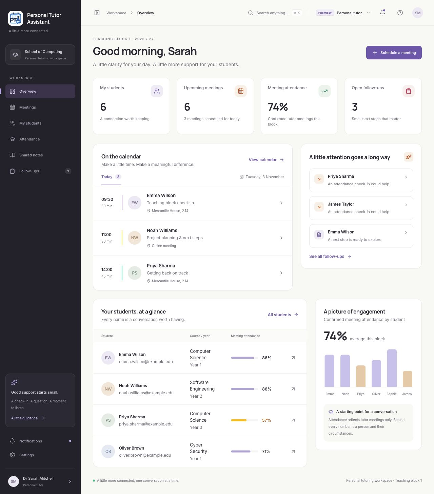

# Personal Tutor Assistant

A personal tutoring workspace for students, personal tutors, student officers, and account administrators.

The current implementation is a **React + TypeScript + Tailwind CSS frontend**, built with Vite. It uses fictional browser-local data to demonstrate the screens and interactions. Flask is planned for the backend; APIs, a database, server authentication, and external messaging have not been implemented.

## Project structure

```text
frontend/                              React application, frontend tests, and design previews
PROJECT_PLAN.md                        Scope, access rules, workflows, and team delivery plan
ACCEPTANCE_TESTS.md                     Broader application acceptance-test specification
Personal tutor assistant project.pdf   Original project pitch
```

The planning documents remain separate from the application source. See [the frontend README](frontend/README.md) for the component structure, preview roles, mock-data behaviour, and integration boundary for the later Flask phase.

## Run the frontend

Use Node 24.22.1, as specified in `frontend/.nvmrc`, or another version supported by `frontend/package.json`.

```sh
cd frontend
npm ci
npm run dev
```

Open the Local URL printed by Vite. The **Preview role** selector switches between the four role experiences. All records are fictional, and changes stay in browser storage.

## Frontend checks

```sh
cd frontend
npm run build
npm test
```

The frontend regression suite covers role views, scheduling conflicts, requests, shared notes, follow-up actions, reassignment, and account-screen previews. The separate acceptance-test document describes the wider planned application and does not imply that backend features are complete.

## Design preview

Personal Tutor Assistant with the updated PTA icon and app name.


